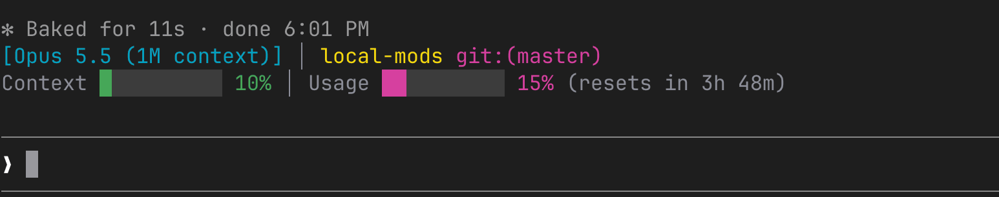
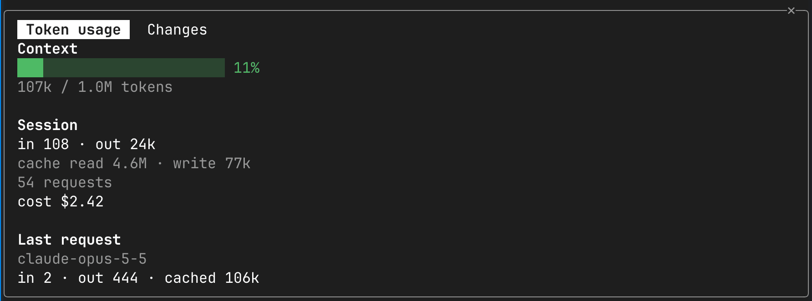
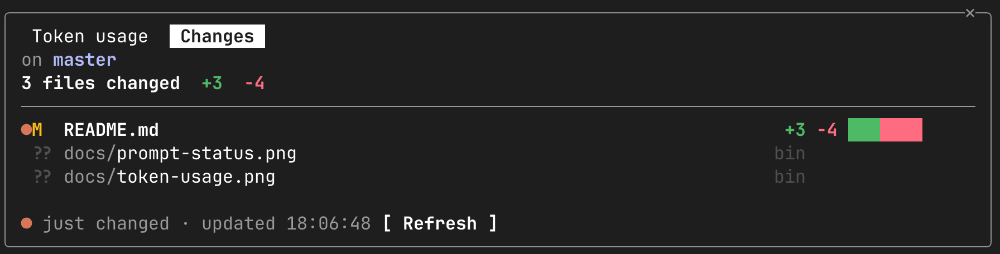

# local-mods

A personal Claude Code plugin marketplace: terminal UI mods (a status band above the prompt and two side panes) and a plugin of skills shared across machines.

| Plugin | What it adds | Command |
| --- | --- | --- |
| [`prompt-status`](prompt-status) | A two-line band above the prompt: model and context window, current directory, git branch, context fill and rate-limit usage | — |
| [`token-usage`](token-usage) | A pane with context fill, session token totals, cost and rate limits | `/token-usage` |
| [`git-changes`](git-changes) | A pane listing the files changed in the working tree, with colored git diff stats | `/changes` |
| [`my-skills`](my-skills) | Personal skills shared across machines | `/my-skills:<skill>` |

## Install

```
/plugin marketplace add matr1xp/local-mods
/plugin install prompt-status@local-mods
/plugin install token-usage@local-mods
/plugin install git-changes@local-mods
/plugin install my-skills@local-mods
```

## Plugins

### prompt-status

Renders above the prompt in every session:



- The model name comes from the latest main-agent request, falling back to the `model` setting.
- Usage shows the five-hour rate limit when it is reported, otherwise the fullest limit.
- The git branch and dirty marker (`*`) refresh after each turn and once a minute. A detached HEAD shows its short commit hash.
- The band hides itself while a survey is showing.

### token-usage

Opens a pane at session start. Run `/token-usage` to reopen it. The pane shows:



- **Context**: fill bar, percentage and tokens used out of the window. In the terminal the bar is an animated flame that grows taller and redder as the context fills (adapted from [burn-meter](https://github.com/OneWave-AI/claude-code-mods)); elsewhere it is a plain text bar.
- **Session**: input, output, cache read and cache write tokens, the request count with subagent requests counted separately, and cost. The cost rolls up to each new reading like an odometer.
- **Last request**: model and token counts for the most recent request.
- **Rate limits**: the 5h, 7d and spend limits with reset times. Each bar turns yellow at 60% and red at 85%.

Running `/clear` resets the session totals.

### git-changes

Opens a pane in interactive sessions. Run `/changes` to reopen it and print a summary. The pane lists every file that differs from `HEAD`, whether staged, unstaged or untracked:



- A status letter for each file (`M`, `A`, `D`, `R`, `??`, …), `+added` / `-deleted` counts and a `git --stat`-style bar. Binary files show `bin`.
- A `●` marker on files whose stats changed since the previous scan.
- The pane rescans after `Edit`, `Write`, `NotebookEdit` and `Bash` tool calls, and every 4 seconds while it is on screen. Press `r` to refresh by hand.
- Git runs with `GIT_OPTIONAL_LOCKS=0`, so polling never holds `index.lock` while you run your own git commands.
- Only the first 40 untracked files get line counts. The rest show as `new`.

### my-skills

A home for personal skills, so they install on every machine like the other plugins. Each skill is a folder under `my-skills/skills/` with a `SKILL.md`, and is invoked as `/my-skills:<skill>`. Claude also loads a skill on its own when a request matches its `description`.

To add a skill, copy `my-skills/skills/example/` to `my-skills/skills/<name>/`, set `name` in the frontmatter to match the folder, and rewrite the description and body.

## Layout

```
.claude-plugin/marketplace.json   marketplace manifest listing the plugins
<plugin>/
  .claude-plugin/plugin.json      name, version, description
  hooks/hooks.json                points at the hooks module
  hooks/register.tsx              the mod: event hooks and UI rendering
  types/index.d.ts                shapes of the state each mod stores
  tests/*.test.ts(x)              tests using claude-code/testing
```

## Development

Run a plugin's tests, then validate the marketplace:

```sh
claude plugin test git-changes
claude plugin validate .
```

After changing a plugin, bump `version` in its `.claude-plugin/plugin.json` so other machines pick up the update with `claude plugin update <plugin>@local-mods`.

## License

[MIT](LICENSE). The software is provided as is, without warranty of any kind, and the author is not liable for any damage arising from its use.
